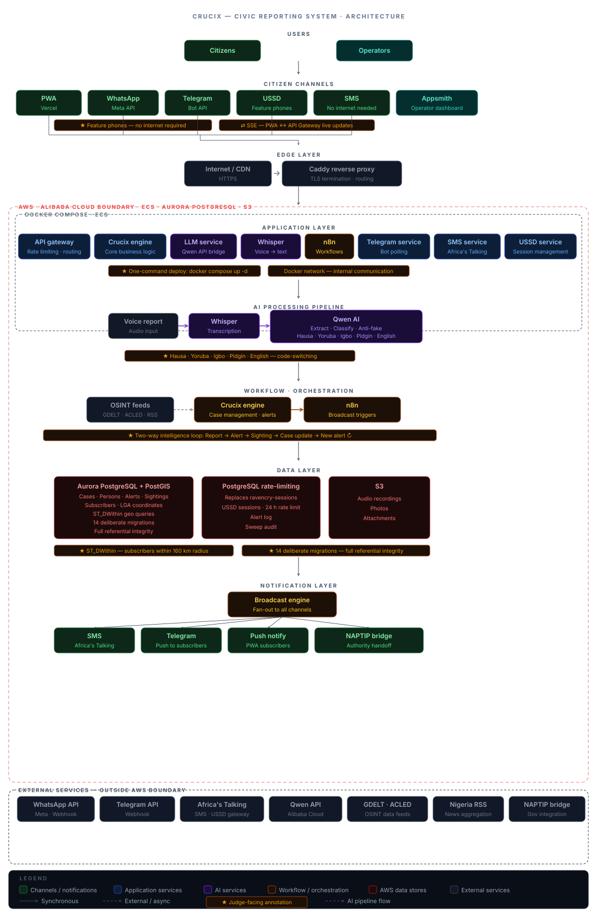

# RAVENCRY

**Real-time AI for Vigilance, Event Notification, and Crisis Response Yielding.**
 A Nigeria-native, multi-channel, AI-powered anti-kidnapping and missing persons rapid alert platform. Citizens report via WhatsApp, USSD (`*384*72836#`), Telegram, SMS, or PWA. Qwen AI triages in Hausa, Yoruba, Igbo, Pidgin, and English. Crucix sweeps OSINT sources. FLASH alerts broadcast via SMS, Telegram, and push to subscribers within 160km.

> **Hackathon:** Qwen Cloud Hackathon · June 2026
>
> **PWA:** [ravencry-web.vercel.app](https://ravencry-web.vercel.app)

---

## Architecture

<p align="center">
  
</p>

**Full context:** [diag_architect.md](diag_architect.md) — service inventory, data
flows, endpoints, DNS routing, architectural decisions, and judge-facing diagram
checklist.

**Data model ERD:** [docs/data-model.mermaid](docs/data-model.mermaid) (render with mermaid.live or `npx mmdc`)

**Feature map:** [features.md](features.md) — hackathon → scale roadmap.

**Build log:** [hackathon_context.md](hackathon_context.md) — key decisions,
debugging discoveries, and architectural rationale.

---

## Quick Start — Docker

```bash
# 1. Clone + env
git clone https://github.com/your-org/ravencry.git && cd ravencry
cp .env.example .env
# Fill in .env — see "Secrets" section below

# 2. Start local Postgres (dev DB)
docker compose -f docker-compose.yml -f docker-compose.dev.yml up -d dev-postgres
# Run migrations + seed: see steps3_db_docker.md (3 min)

# 3. Start the stack
docker compose -f docker-compose.yml -f docker-compose.dev.yml up -d
docker compose ps  # all services healthy
```

**Full dev DB guide:** [steps3_db_docker.md](steps3_db_docker.md)

## Quick Start — Node (no Docker)

```bash
# Each service runs independently:
cd services/api     && npm install && npm run dev   # :3003
cd services/llm     && npm install && npm run dev   # :3002
cd vendor/crucix  && npm install && npm run dev   # :3001
cd services/telegram && npm install && npm run dev  # :3005
cd services/sms     && npm install && npm run dev   # :3006
cd services/ussd    && npm install && npm run dev   # :3007
```

Requires PostgreSQL 16 with PostGIS on `localhost:5432` (or set `DATABASE_URL`).

## Remote — ECS Deployment

1. Provision ECS (8GB RAM), Ubuntu 24.04, 30GB gp3 — see [todo.md T-007](prompt-system/specs/todo.md)
2. Provision Aurora PostgreSQL + S3 (PostgreSQL rate limiting replaces DynamoDB sessions) — see [todo.md T-008–T-012](prompt-system/specs/todo.md)
3. `git clone` → `cp .env.example .env` → fill from AWS Secrets Manager
4. `docker compose build && docker compose up -d`
5. Caddy handles TLS automatically via Let's Encrypt

> **Known issue:** Stop host Caddy first — `sudo systemctl stop caddy && sudo systemctl disable caddy` — see [hackathon_context.md §6](hackathon_context.md)

---

## Services

| Service | Port | Technology | Purpose |
|---------|------|------------|---------|
| **api** | 3003 | Express 4 + TypeScript | Public API gateway, SSE, operator endpoints |
| **llm** | 3002 | Express + TypeScript | Qwen AI: extract, classify, OSINT, anti-fake |
| **crucix** | 3001 | Express + Node.js 20 | OSINT sweep engine, delta detection, FLASH webhook |
| **telegram** | 3005 | Express + TypeScript | Telegram bot, FLASH channel broadcast |
| **sms** | 3006 | Express + TypeScript | SMS via Africa's Talking (batch, geofenced) |
| **ussd** | 3007 | Express + TypeScript | USSD menu handler (`*384#`) |
| **whisper** | 8000 | Flask + faster-whisper | Audio transcription (voice notes → text) |
| **n8n** | 5678 | n8n (Docker) | Workflow orchestration (WF-01, WF-02, WF-03) |
| **caddy** | 80, 443 | Caddy 2 | Reverse proxy, TLS, subdomain routing |

**AWS/Alibaba Databases:**
| Database | Purpose |
|----------|---------|
| **Aurora PostgreSQL** (PostGIS) | Cases, persons, subscribers, alerts, sightings — 14 migrations, full referential integrity |
| **PostgreSQL rate limiting** | USSD sessions, 24h rate limit — replaces DynamoDB `ravencry-sessions` (migration 015) |
| **S3** | Audio uploads (.ogg), photos, attachments — lifecycle policies |

---

## Secrets — .env Reference

Copy `.env.example` → `.env`. Full reference: [.env.example](.env.example)

| Variable | How to get it |
|----------|--------------|
| `LLM_API_KEY` | [Qwen DashScope](https://dashscope.console.aliyun.com/apiKey) or [DeepSeek](https://platform.deepseek.com/api_keys) or [OpenAI](https://platform.openai.com/api-keys) |
| `DATABASE_URL` | AWS RDS → Aurora cluster → Connectivity & security → Endpoint |
| `AT_API_KEY` / `AT_USERNAME` | [Africa's Talking Sandbox](https://account.africastalking.com) → Settings → API Key |
| `TELEGRAM_BOT_TOKEN` | Telegram → @BotFather → /mybots → API Token |
| `META_WHATSAPP_TOKEN` | [Meta Developers](https://developers.facebook.com) → App → WhatsApp → API Setup |
| `VAPID_PUBLIC_KEY` / `VAPID_PRIVATE_KEY` | Generate: `npx web-push generate-vapid-keys` |
| `N8N_WEBHOOK_SECRET` | Generate: `openssl rand -hex 32` |
| `AWS_ACCESS_KEY_ID` / `AWS_SECRET_ACCESS_KEY` | AWS IAM → Users → ravencry-deploy → Security credentials |
| `JWT_SECRET` | Generate: `openssl rand -hex 64` |

---

## Contributing

RAVENCRY is not just software — it's infrastructure for a safer Nigeria.

**Our long-term vision:** Self-deploying satellite-linked ground stations and
fully automated drones running 24/7 search-and-detect missions over Nigeria's
most vulnerable corridors. The code you write today could one day guide a drone
to a missing child.

**Ways to contribute:**

- **Code:** Pick any open task in [todo.md](prompt-system/specs/todo.md)
- **Multilingual review:** Verify Hausa/Yoruba/Igbo/Pidgin prompt accuracy
- **OSINT sources:** Add Nigerian news feeds, community radio, social media monitors
- **Hardware:** Raspberry Pi edge nodes, solar power rigs, drone integrations (V2 backlog)
- **Security:** Audit the anti-fake pipeline. False positives harm real victims.

See [design.md](prompt-system/specs/design.md) for architecture.

---

## Vercel — Deploy `apps/web` Separately

```bash
cd apps/web
pnpm install
# Set env vars in Vercel dashboard:
#   NEXT_PUBLIC_API_URL=https://api.ravencry.cv
#   NEXT_PUBLIC_VAPID_KEY=<from .env>
pnpm build   # verify it compiles
```

Then in Vercel dashboard: Import Git repo → set **Root Directory** to `apps/web`.
Vercel auto-detects Next.js. If using pnpm, set **Install Command** to `pnpm install`.

> The PWA has no backend build step — it's a static Next.js export that calls
> the API Gateway over HTTPS. `next.config.mjs` already has `images.unoptimized`
> (needed for static export).

