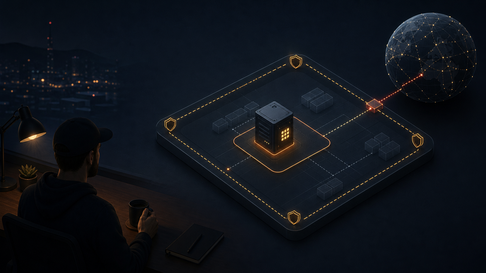

# Terraform, ECS, and a $40 voucher



The hackathon was on Alibaba Cloud, and the voucher was $40.

Enough to sit down and ask: what gets RAVENCRY running on Alibaba Cloud without turning the work into a cloud debate?

RAVENCRY is not a tiny app. Docker Compose stack. API services, AI services, messaging adapters, Caddy, Appsmith, a few supporting pieces that all need to come up in the right order. My only requirement for this first pass: a repeatable compute setup.

So I wrote the infrastructure in Terraform and aimed it at ECS.

<!-- Image slot: Alibaba Cloud ECS console showing the target instance or instance list. Hide account IDs, public IPs if needed, and billing details before publishing. -->

## Starting with the smallest deployment

I kept the plan deliberately small.

A Linux machine that could run Docker Compose. A stable public IP. A security group with the ports the app needed. A setup script that made a fresh server ready for work without manual package installs.

The resulting infrastructure:

- ECS for the compute instance
- EIP for a stable public address
- VPC and VSwitch for the network base
- security group rules for `22`, `80`, `443`, and `3001`
- RAM role support for later Alibaba Cloud access from the instance
- Terraform so the whole thing could be repeated
- user data so the instance could bootstrap itself on first boot

The selected ECS type in the repo is `ecs.g8ine.large`: 2 vCPU and 8GB RAM. Enough room for Docker without burning through the voucher too quickly.

The module stayed small because I wasn't solving production networking yet. I only needed enough infrastructure to deploy the stack repeatedly without touching the console.

## Building the Terraform module

The Alibaba Cloud infrastructure lives in `infra/aliyun/`.

The main file starts with the Alicloud provider, using the `default` profile and the `eu-west-1` region from `variables.tf`. Credentials stay out of the Terraform files. If the Alibaba Cloud CLI is already configured, Terraform picks up the same local profile.

Networking ended up being straightforward:

```hcl
resource "alicloud_vpc" "ravencry" {
  vpc_name   = "${var.project}-vpc"
  cidr_block = "10.0.0.0/16"
}
```

A VSwitch takes `10.0.1.0/24` inside the first available zone returned by the provider. I didn't need a complex network design for this stage. Just one ECS instance with somewhere to live.

I exposed only four ports: SSH, HTTP, HTTPS, and `3001` — the dev access port for the Crucix API. Leaving that last one visible in code was deliberate. A future security pass can tighten it. During a hackathon build, the more dangerous mistake is magic console settings that nobody can see later.

<!-- Image slot: Architecture diagram showing VPC, VSwitch, ECS, EIP, security group, and RAM role. Export from Excalidraw, Mermaid, or the Alibaba Cloud architecture tool. -->

The ECS resource pulls the latest Ubuntu 24 image from Alibaba Cloud:

```hcl
data "alicloud_images" "ubuntu" {
  name_regex  = "^ubuntu_24"
  most_recent = true
  owners      = "system"
}
```

30GB ESSD system disk, the selected ECS type, the security group, and the generated key pair:

```hcl
resource "alicloud_instance" "ravencry" {
  instance_name   = "${var.project}-prod"
  host_name       = "ravencry"
  instance_type   = var.ecs_instance_type
  image_id        = data.alicloud_images.ubuntu.images[0].id
  vswitch_id      = alicloud_vswitch.primary.id
  security_groups = [alicloud_security_group.ecs.id]

  system_disk_category = "cloud_essd"
  system_disk_size     = 30
  key_name             = alicloud_ecs_key_pair.ravencry.key_pair_name
  password             = var.ecs_password

  user_data = base64encode(templatefile("${path.module}/user_data.sh", {}))
}
```

`ecs_password` is marked sensitive and defaults to an empty string. Key-based SSH is the preferred path. A temporary password fallback lets you prove first access before committing to key-only.

## Why the EIP is separate

The ECS instance has `internet_max_bandwidth_out = 0`. All public traffic flows through the EIP.

```hcl
resource "alicloud_eip" "ravencry" {
  bandwidth            = 10
  internet_charge_type = "PayByTraffic"
  payment_type         = "PayAsYouGo"
  address_name         = "${var.project}-eip"
}
```

Routing public traffic through the EIP means the instance doesn't need its own outbound bandwidth allocation — the EIP carries public traffic, the instance talks to the VPC directly, and the whole thing stays aligned with a limited hackathon budget.

The public address becomes part of deployment muscle memory. SSH. DNS. Webhooks. Callback URLs. Anything public-facing gets easier when the IP survives a stop-start cycle.

The module also creates a RAM role:

```hcl
resource "alicloud_ram_role" "ecs" {
  role_name                   = "${var.project}-ecs-role"
  assume_role_policy_document = data.alicloud_ram_policy_document.ecs_trust.document
  description                 = "RAVENCRY ECS instance role"
}
```

Future integrations would need an obvious route to OSS or KMS without hardcoded keys. The role is attached, waiting.

## Bootstrapping Ubuntu

Most of the real work happens in `user_data.sh`.

On first boot: updates the machine, installs Docker and Compose v2, enables Docker, installs Caddy, installs Node.js 20, adds the PostgreSQL client, installs git, then installs the Alibaba Cloud CLI.

The Caddy part is intentional. The script installs Caddy from the official package path, then stops and disables the host service:

```bash
systemctl stop caddy
systemctl disable caddy
```

RAVENCRY runs Caddy inside Docker. A host-level Caddy service binding `80` and `443` would fight the container, and that is not the kind of mystery I want at 1 a.m.

The final line is unremarkable:

```bash
echo "=== RAVENCRY ECS setup complete ==="
```

A completion marker like this makes cloud-init logs much easier to scan when provisioning a fresh instance. You're watching a wall of text scroll past. You want a signal at the end.

<!-- Image slot: Terminal screenshot showing cloud-init completion, installed Docker version, or `docker compose ps` after the stack is running. Blur secrets and hostnames as needed. -->

## Checking availability before apply

Before applying anything, I checked regional availability from the CLI:

```powershell
aliyun ecs DescribeAvailableResource --RegionId eu-west-1 --DestinationResource InstanceType --InstanceType ecs.g8ine.large
```

Instance families vary by region and availability zone. Terraform can describe what you want. The platform has the final say on what can be created right now. For a hackathon, this matters — you don't want to spend an hour polishing Terraform around an instance type the region can't give you.

My rule: check availability first, then write the final variable value. I also checked `g7.large`, `g8a.large`, `g8i.large`, and `g7a.large`. None were available in `eu-west-1` at the time of deployment. `ecs.g8ine.large` was the only large-type option for this account on that day. Instance family availability varies by region, zone, and account — your results may differ.

## The mistakes that slowed me down

SSH caused the first surprise.

I typed `ssh ubuntu@<ip>` and got `Permission denied (publickey)`. Checked the key, checked the console, checked the key again. Everything looked right. The problem was the username: the image I provisioned only accepted `root` for initial SSH. Years of typing `ubuntu` on other clouds, my fingers got there before my brain had a chance to object. The fix is ten seconds once you know. The discovery is longer. (The `user_data.sh` bootstrap script adds the `ubuntu` user to the Docker group, so verify the actual image login user before relying on either default.)

Keep the password fallback wired in Terraform while you're proving access. `ecs_password` is marked sensitive in the variables file and defaults to empty. Set it temporarily while you're getting comfortable with the image behavior.

PowerShell came next.

Public keys are long strings. A backtick continuation that looks harmless can silently turn a valid command into a command with an empty argument. Intermediate variables are cleaner:

```powershell
$PubKey = Get-Content "$env:USERPROFILE\.ssh\id_ed25519.pub" -Raw
aliyun ecs ImportKeyPair --KeyPairName ravencry-key --PublicKeyBody $PubKey
```

Pacing caught me the hard way.

A run of `terraform apply`, then `terraform destroy`, then `terraform apply` again — all within a short window — triggered an anti-fraud flag. Alibaba Cloud's security layer did its job. The pattern looked like automation abuse, and the platform responded before anything could be created. Space out the runs. Apply, inspect, wait for the instance state to settle, then decide whether to destroy or proceed. A few minutes between Terraform operations keeps you on the right side of the throttle.

Those three got me into the instance. Getting Docker to actually run the stack took a few more.

The first deploy hit a DNS dead end. Containers couldn't resolve anything. `systemd-resolved` runs a stub resolver at `127.0.0.53`, unreachable from inside Docker's network namespace. `dns: [8.8.8.8, 8.8.4.4]` in the Compose file. Five minutes of `nslookup` debugging, one line of YAML.

Then the healthchecks failed. Not because the services were down.

Because the containers didn't even have `curl`.

The `node:22-alpine` base image ships without it. No `wget` either. The healthcheck command itself was crashing before it could ask the service if it was alive. Three Dockerfiles needed `RUN apk add --no-cache curl`. After the rebuild, all eleven rows turned green.

Then `npm ci` refused to run inside a container. Stale lockfile. Newer transitive dependencies — `@emnapi/core`, `@emnapi/runtime` — were missing. `rm -f package-lock.json && npm install` on the instance fixed it. I made a note to check lockfiles into the repo more carefully.

Caddy provisioned TLS certificates automatically during deployment. No config beyond the domain names in the Caddyfile. I watched the logs scroll past `certificate obtained successfully` and realized I hadn't thought about HTTPS since writing the Terraform. It just worked.

When `docker compose ps` showed every service as `(healthy)` — api, llm, crucix, telegram, sms, ussd, whisper, n8n, naptip, appsmith, caddy — I took a screenshot. Eleven containers, zero red rows, running on an `ecs.g8ine.large` provisioned from four Terraform files and a bootstrap script.

## What stayed in the repository

The best artifact is `infra/aliyun/` plus `steps_aliyun.md`: the code and the operator notes. Terraform tells you what should exist. The guide explains how I actually brought the environment online.

A future reader can see the infrastructure in `main.tf`, the tunable values in `variables.tf`, the package setup in `user_data.sh`, and the final reminders in `outputs.tf`. Then they can open the steps file and follow the CLI path without guessing what I had in my terminal.

<!-- Image slot: Screenshot of Terraform output after apply, or the ECS public IP panel. Hide public IP if you do not want it published. -->

## I'd build it this way again

One VPC. One VSwitch. One security group. One ECS instance. One EIP. One RAM role. One first-boot script.

For production: tighten SSH access, move the dev API port behind a private path or VPN, attach managed policies to the RAM role, and move runtime configuration into a proper secret flow.

For a hackathon build, this was the right level of structure. A working Alibaba Cloud target without hiding decisions in the console.

The $40 voucher was the hook. ECS and Terraform were the part that ships. And the best artifact isn't the instance — it's the module and the guide sitting in the repo, ready for the next person who opens a fresh Alibaba Cloud account and wants to skip the guesswork.

With the infrastructure in place, the next challenge is the application itself.
