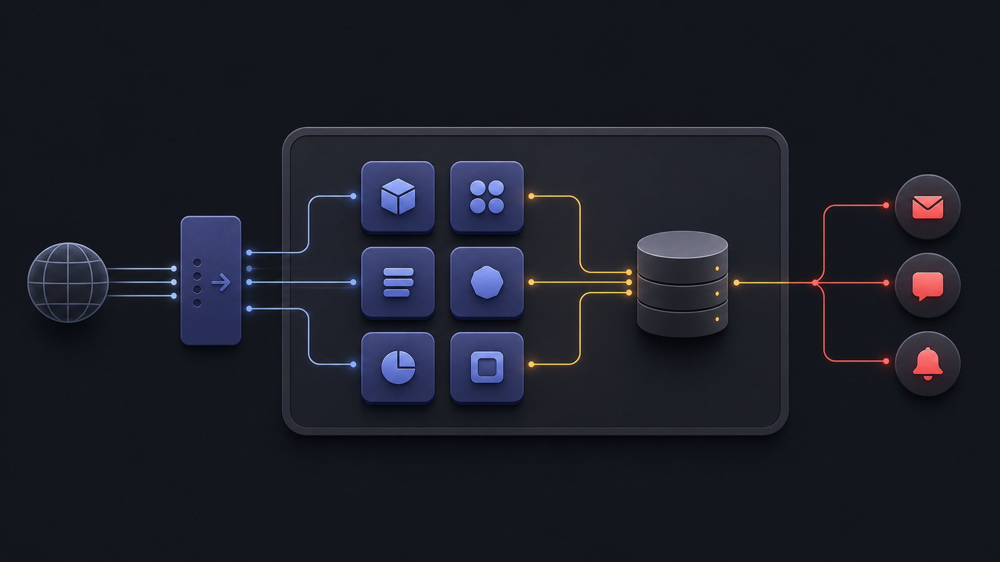
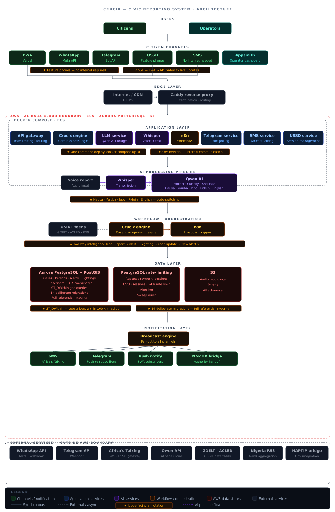

# Every service in its place

*How RAVENCRY’s deliberately small deployment turns eleven containers into one understandable system.*

`docker compose ps` returns eleven rows. All green. All `(healthy)`.

That single command is the whole deployment story. One VPC, one VSwitch, one ECS instance, one EIP, and eleven containers orchestrated by Compose. The architecture behind RAVENCRY isn't clever in the way that impresses system design interviews. There's no Kubernetes, no service mesh, no event bus. It's eleven processes talking to each other over HTTP and one PostgreSQL database.

I spent thirty-nine hours building this. Here's what each piece does and what I was thinking when I chose it.

*The deployment at a glance: one ECS host, Docker Compose, a PostgreSQL data layer, and focused services at the edge.*

## The API gateway isn't just a router

Port 3003. Express 4. Fifteen declared routes across eight route files.

At first glance it's a thin proxy. Report submission comes in. The gateway validates, transforms, forwards to the LLM service, waits for triage, inserts into Aurora, returns. Simple enough.

But the gateway owns two decisions that shape the entire system.

First: every endpoint returns `{ error, code, details? }`. No exceptions. When the LLM service times out, the gateway doesn't crash or return a 500 with a stack trace. It returns `{ error: "triage_unavailable", code: "UPSTREAM_TIMEOUT" }`. The frontend and the Telegram bot and the USSD handler all parse the same shape. I've debugged enough distributed systems to know that inconsistent error formats multiply support burden by ten.

Second: the approval endpoint has a race condition guard built in. `UPDATE cases SET status = 'broadcast' WHERE id = $1 AND status = 'pending' RETURNING *`. If `rows.length === 0`, someone else got there first. Double-broadcast prevented at the database level. Not in application logic. Not in a queue. In a single SQL statement.

The gateway also streams live alerts to the PWA via SSE. No WebSocket handshake. No library dependency. Just a long-lived HTTP connection and `text/event-stream`. For a hackathon frontend that needs to show alerts as they happen, SSE is the right tool. It's simpler, it works through proxies, and the browser handles reconnection natively.

I chose Express because I know it. Not because it's the fastest or the shiniest. I can write Express routes from memory at 3am. That matters during a hackathon more than any benchmark.

## The brain speaks five languages

Port 3002. Four endpoints. One trick.

The LLM triage service is actually four prompt templates wrapped in a thin Express server. `/extract` pulls structured fields from raw text in Hausa, Yoruba, Igbo, Pidgin, or English. `/classify` assigns FLASH, PRIORITY, or ROUTINE. `/classify-osint` evaluates news articles swept by Crucix. `/check-authenticity` runs anti-fake detection.

Four prompts. Four endpoints. That's the whole service.

The provider abstraction took thirty minutes to build. `LLM_PROVIDER` switches between `qwen`, `openai`, `deepseek`, and `gemini`. Everything else — the endpoint signatures, the response schemas, the validation layer — stays identical. During the hackathon I ran Qwen via DashScope because that was the competition track. During testing I flipped to DeepSeek because it was free. The code didn't change.

Post-LLM validation catches the inevitable hallucinations. Qwen occasionally returns malformed JSON, or a field in the wrong type, or a confidence score that's missing entirely. The validation layer catches those before they hit the database. Missing fields get safe defaults. Confidence below 0.5 routes to human review. The system degrades gracefully.

I learned one thing about temperature the hard way: for safety-critical classification, you don't want creativity. You want the same answer every time. `temperature: 0.1` on every Qwen call. The model still has enough flexibility for linguistic variation, but it won't classify the same Hausa report as FLASH on one run and ROUTINE on the next.

## The OSINT engine reads 34 sources in parallel

Port 3001. Forked from CrucixAI/crucix. Five Nigeria-specific modules bolted onto twenty-nine global sources.

The sweep runs on a configurable interval — default five minutes. All thirty-four sources fire simultaneously via `Promise.allSettled()`. If one RSS feed times out or one GDELT query returns garbage, the other thirty-three still complete.

The Nigeria modules: naptip-rss pulls from ten feeds (HumAngle, Premium Times, Daily Trust, The Cable, Punch, Vanguard, Guardian NG — every major Nigerian newsroom). gdelt-nigeria fires three queries for kidnapping events, child-specific incidents, and school attacks. citizen-reports polls Aurora for cases flagged `pending_sweep` — reports that citizens submitted but that need OSINT corroboration before broadcast. acled-nigeria pulls structured conflict data from ACLED with OAuth2 authentication.

The delta engine compares each sweep against the previous run. Genuinely new events get scored against a keyword tier map that works across English, Hausa, Yoruba, Igbo, and Pidgin. "child" adds five points. "school" adds five. "found" subtracts three. "rescued" subtracts three. Score eight or above and Crucix fires a webhook to n8n. Below eight goes to the operator review queue.

I discovered that HumAngle uses WordPress tags for their feed structure, not categories. `/category/kidnapping/feed/` returns 404. `/tag/kidnapping/feed/` returns 200. Five tags — kidnapping, banditry, insurgency, abduction, boko-haram. Ten feeds total. Finding that took an hour of staring at WordPress URL patterns.

## The delivery layer is four services that don't trust each other

Telegram on port 3005. SMS on 3006. USSD on 3007. NAPTIP bridge on 3008.

Each one handles failure differently. The Telegram bot acks webhooks in under ten milliseconds and processes asynchronously because Telegram retries slow responses, which would create duplicate cases. FLASH broadcasts try `sendPhoto` with MarkdownV2 first, fall back to plain text if the parse fails, and notify the ops channel if all attempts fail. The bot also auto-detects case IDs — someone types `NR-2026-000001` in plain text and it triggers a status lookup without needing the `/status` prefix.

The SMS service wraps Africa's Talking in batch chunks of one hundred recipients. AT's sandbox rejects custom sender IDs, so the code checks the username and strips the `from` field automatically when it sees `sandbox`. Phone encryption was designed as AES-256-GCM with a KMS key. `decryptPhone()` doesn't exist yet. The hackathon workaround is an env var called `AT_SANDBOX_TEST_PHONES` — n8n sends subscriber UUIDs, the SMS service ignores them and routes to the sandbox numbers instead. Ugly. Functional. Documented.

The USSD handler is stateless. Africa's Talking accumulates user input in the `text` parameter as asterisk-delimited segments: `1*Amina*8*Kano`. The handler splits on `*` and counts the depth to determine which menu the caller is on. No session storage. No database reads during navigation. Four branches: report missing person, report sighting, check active alerts, subscribe. Rate limiting — three reports per phone per twenty-four hours — fails open. If the rate-limit check errors, the report proceeds. A kidnapped child isn't blocked because a database is down. (The original DynamoDB-based rate limiter was replaced with a PostgreSQL `ussd_rate_limits` table during the Alibaba Cloud migration — simpler, cheaper, and no additional SDK.)

The NAPTIP bridge is a mock. It accepts the same CAP-JSON format the real NAPTIP API would use, logs the payload, and returns 200. For the hackathon demo, that's enough. Real NAPTIP integration requires a government API key and a formal partnership. The bridge exists so the code path is tested even if the endpoint is fake.

## Whisper runs on CPU alongside seven other services

Port 8000. Flask. faster-whisper with int8 quantization.

The model fits in RAM alongside seven Node.js services and n8n on an 8GB machine. VAD filter strips silence before transcription. Language detection maps ISO codes to readable names. The model pre-downloads at Docker build time so first request doesn't trigger a multi-gigabyte download.

I chose faster-whisper because it was the only option that would coexist peacefully. OpenAI Whisper performs best with a GPU (CPU inference is possible but slower). WhisperX needs more memory. faster-whisper with int8 on CPU is slower — thirty seconds for a thirty-second voice note — but it works in the constraints I had. When funding isn't a constraint, I'd train a custom model on Nigerian voices. General-purpose ASR struggles with Hausa inflections, Yoruba tones, Igbo consonant clusters, and the way Nigerians switch between three languages in a single sentence. A specialized model trained on Nigerian voices could meaningfully improve both speed and accuracy for the Nigerian language mix. That's not a hackathon problem.

n8n on port 5678 runs three workflows. WF-01: WhatsApp voice note comes in, Whisper transcribes, Qwen extracts and classifies, Aurora stores, Meta replies. WF-02: FLASH case triggers PostGIS geofence query, parallel delivery to Telegram, SMS, Push, and NAPTIP, alerts table updated. WF-03: Crucix sweeps, Qwen classifies OSINT articles, `pg_trgm` dedups against existing headlines, draft case inserted.

n8n was the right hackathon choice because the visual workflow editor is demo gold. You can show judges the flow diagram, click through nodes, and they understand the system in thirty seconds. For production, I'd replace it with a proper orchestrator. But for a three-minute demo, the visual editor earned its RAM.

## The data layer has opinions

Aurora PostgreSQL with PostGIS. Fifteen migration files. Nine tables with full referential integrity. Foreign keys enforced. `updated_at` triggers on every table. Enums for every state machine: `case_status` tracks pending_triage → in_triage → pending_review → active → broadcast_complete → cold → resolved → false_report. `alert_tier` is FLASH, PRIORITY, or ROUTINE. `input_channel` knows whether the report came from WhatsApp, Telegram, USSD, SMS, the PWA, OSINT ingestion, or manual operator entry.

PostGIS `GEOGRAPHY(POINT,4326)` columns power the subscriber geofence. `ST_DWithin` with a 160km radius. When a FLASH alert fires, the geofence query returns every subscriber within range, and those are the people who get the SMS and push notification. No noise for someone in Lagos when the alert is in Maiduguri.

`pg_trgm` handles fuzzy name matching and headline deduplication. Two reports about the same incident with slightly different phrasing get flagged as potential duplicates. The operator reviews and merges. Without this, every news article about the same kidnapping creates a separate case.

S3 stores audio uploads from WhatsApp voice notes and photos from the PWA. The intended lifecycle policy auto-expires uploads after three days — verify this against the deployed AWS configuration. The system doesn't need to keep a six-month archive of voice recordings. It needs enough data to process the report and then it can let go.

The original DynamoDB design ran three tables on on-demand billing: sessions for WhatsApp and USSD conversation state with TTL expiry, alert delivery tracking, and an immutable sweep audit log. The DynamoDB choice was pragmatic: I needed session storage that wouldn't bloat Aurora and wouldn't require schema migrations for every workflow change. During the Alibaba Cloud migration, DynamoDB was replaced with PostgreSQL tables (e.g., `ussd_rate_limits`) — simpler, cheaper, and no additional SDK.

## Caddy earns its place

The reverse proxy runs Caddy 2 in Docker. Let's Encrypt provisions TLS certificates automatically — no cron job, no certbot, no renewal script. Subdomain routing: `api.ravencry.cv` hits the API gateway, `crucix.ravencry.cv` hits the OSINT engine, `n8n.ravencry.cv` hits the workflow editor, `ops.ravencry.cv` hits the Appsmith dashboard.

Bot scanners get a 410 Gone response on twenty known probe paths: `.env`, `.git/config`, `wp-json`, `xmlrpc.php`, the usual suspects. Security headers on every response: `X-Frame-Options: DENY`, `X-Content-Type-Options: nosniff`, `Referrer-Policy: strict-origin-when-cross-origin`.

Docker DNS is set to `8.8.8.8` because `systemd-resolved` binds a stub at `127.0.0.53` that's unreachable from inside containers. That discovery cost me an hour of `nslookup` and one line of YAML. I mentioned it in the infrastructure article already. It bears repeating because it's the kind of thing you only learn at 2am on a real deploy.

The `caddy:2-alpine` image ships bare. No `rate_limit` plugin. The Caddyfile I wrote originally had a rate limit block that caused a config parse error at startup. Removing three lines fixed it. The lesson: the official Docker image gives you core Caddy. Plugins need a custom build.

## What I'd do differently next time

Huginn was in the original design. RSS polling, event processing, webhook orchestration — it does what Crucix and n8n together already handle. At two gigabytes of RAM just to run, it was the first thing I cut. The architecture is cleaner without it.

Appsmith is running but not configured. The ops dashboard needs charts, case lists, approval workflows. There's a container on port 8080 that starts, passes its healthcheck, and sits there empty. The demo showed the Telegram bot as the operator interface. That was the right call for thirty-nine hours. Not for week eight.

The phone encryption gap is the one I think about most. The schema has `phone_encrypted BYTEA` and `phone_hash_sha256 TEXT`. The design specifies AES-256-GCM with a KMS key. `decryptPhone()` doesn't exist. There's no KMS key in Secrets Manager. The seed data uses mock BYTEA values. The SMS service works because of that sandbox env var. It's the most visible gap in the system and the first thing that needs real implementation.

I'd build the anti-fake pipeline differently with more time. Right now it's QW-04's textual analysis plus EXIF metadata checks. Reverse image search — Google Vision or TinEye — would catch recycled photos being passed off as current. That's a post-hackathon item.

Everything else runs. One command. The architecture is deliberate. Eleven containers, fifteen migrations, five languages, four delivery channels, one database, one reverse proxy. Each piece has a reason for being there. Nothing is included because a tutorial told me to.