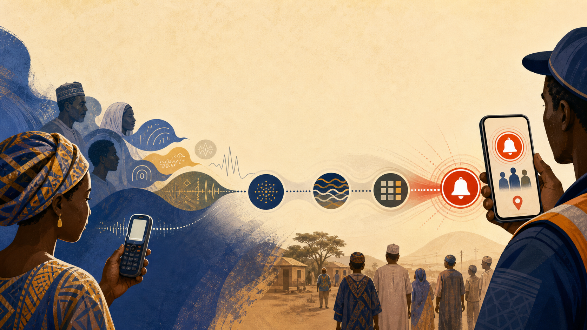

# Teaching machines to hear Hausa

*What it took to make a multilingual triage pipeline preserve Nigerian language, place names, and urgency.*

A mother in Zamfara picks up her feature phone and dials `*384*72836#`. She types slowly on a T9 keypad. Her daughter, Fatima, age nine, hasn't come home from the market. The USSD menu asks what happened. She types what she can.

"an sace yata Fatima shekara 9 a kasuwar Maru"

The text hits our API gateway, flows to the LLM triage service, and Qwen reads it. Pulls out the name. The age. The location — Maru Market, Zamfara State. Classifies it as FLASH because the victim is a child. Within thirty seconds, subscribers within a hundred and sixty kilometers of Maru get a Telegram alert with Fatima's details.

That pipeline runs on four prompts. Four carefully constructed pieces of text that tell Qwen what to do. Getting those prompts right took most of the thirty-nine hours.

## The four questions

Every report that enters RAVENCRY passes through a sequence. Four prompts, four answers.

QW-01 reads the raw text and extracts structured fields. Name, age estimate, gender, clothing description, distinguishing marks, last seen location, last seen time, circumstances. The input is whatever the citizen typed — Hausa, Yoruba, Igbo, Pidgin, English, or any mix. The output is JSON with nullable fields.

QW-02 reads the structured fields and classifies severity. FLASH means broadcast immediately: child abduction, active kidnapping, school attack, mass casualty. PRIORITY means operator review within the hour. ROUTINE means log and monitor. The prompt contains specific escalation rules: any victim under eighteen is automatic FLASH. Any report containing the Hausa phrases "an sace yaro" or "an sace yarinya" — a boy was kidnapped, a girl was kidnapped — triggers immediate escalation.

QW-03 reads a news article headline and body, determines whether it describes an actionable kidnapping or missing person event, and assigns a tier. This runs against every article Crucix sweeps from thirty-four sources. Most articles aren't relevant. The ones that are get inserted as draft cases for operator review.

QW-04 reads the original report text plus any attached metadata — photo EXIF, timestamp consistency, reporter history — and returns either `legitimate` or `hold_for_review`. The default is `legitimate`. It takes three or more strong red flags to flip to `hold_for_review`. I'll explain why in the next article.

Four prompts. Four hundred lines of carefully tuned system instructions. I tested them against twenty-three hand-written cases in five languages. Here's what I learned about making Qwen work for Nigerian languages.

## What other models got wrong

I tested the same prompts against four models. The differences were stark.

GPT-4o handled Pidgin well — no surprise, it's trained on a lot of West African English variants. But it struggled with Hausa. "An sace yarinya a kasuwa" came back with the location field set to "market" and an empty LGA. GPT-4o knew "kasuwa" meant market but didn't place it. It also occasionally "corrected" Nigerian names. "Chijioke" became "Chijioke (probably male, Igbo)" — useful annotation, but that parenthetical was going to end up in the database as part of the name field.

DeepSeek V3 was the cheapest option by far but produced the weakest multilingual results. Igbo reports came back nearly empty. Hausa extraction was hit or miss. Yoruba fared slightly better but still missed locations consistently. For a system where a missed location means a geofence query returns zero subscribers, that's a hard fail.

Gemini 2.5 Pro handled Pidgin naturally — Google's training data clearly includes Nigerian English variants. But Igbo and Yoruba were weak, and the model defaulted to English approximations of place names. "Oja Oba" became "Oba Market" — technically a translation, but now the geofence query is looking for a place name that doesn't exist in the LGA coordinates table.

Qwen handled Hausa and Yoruba better than any other model I tested. The code-switching was the biggest surprise. Nigerians don't speak in clean language boundaries. A single sentence often mixes three. "My pikin don disappear, a ganshi a Kasuwan Shanu" — Pidgin framing, Hausa location, Pidgin verb. Qwen extracted "pikin" as child, "Kasuwan Shanu" as the location, and classified it correctly. GPT-4o got confused by the mid-sentence switch and returned a lower confidence score. DeepSeek just returned null for location.

The model comparison table from my notes:

> **Important:** these are informal, task-specific observations from twenty-three hand-written cases—not a general benchmark of the models.

| | Hausa | Yoruba | Igbo | Pidgin | Code-switching |
|---|---|---|---|---|---|
| Qwen (qwen-plus) | Strong | Strong | Good | Strong | Best tested |
| GPT-4o | Moderate | Moderate | Weak | Strong | Moderate |
| DeepSeek V3 | Weak | Weak | Weak | Moderate | Poor |
| Gemini 2.5 Pro | Moderate | Moderate | Weak | Strong | Moderate |

For a Nigerian alert system in our informal testing, Qwen delivered the strongest multilingual performance. Not because it's perfect — all models struggled with at least one language — but because it was the most consistent at preserving location names across the five languages we tested. These results are task-specific observations from a small test set, not a general ranking of the models.

## The patterns that actually worked

Five prompt patterns emerged from testing. Each one solved a specific failure mode.

**Tell the model what languages to expect. Explicitly.**

Without a language instruction, Qwen assumes English. A Hausa report with no English framing gets treated as garbled English and the extraction quality drops. Adding "You will receive reports in Hausa, Yoruba, Igbo, Nigerian Pidgin, English, or any mix of these languages. Process the input language as-is." at the top of every prompt fixed this. The model stops trying to translate first and extracts from the source language directly.

**Protect proper nouns.**

Without explicit instructions, Qwen sometimes normalizes Nigerian place names. "Kasuwan Shanu" becomes "Cattle Market." "Rijiyar Zaki" becomes "Zaki Well." These are real locations in Nigeria, not metaphors. The fix: "Extract proper nouns exactly as written. Do not normalize, translate, or correct spelling of Nigerian names and places. Kasuwan Shanu, Sabon Gari, Rijiyar Zaki are place names — preserve them exactly." One paragraph in the system prompt that prevents subtle data corruption.

**Null is better than hallucination.**

Safety systems need missing data more than they need wrong data. If Qwen can't determine an age from the text, returning null is better than guessing seventeen. The prompt includes: "If you cannot confidently determine a field from the input, return null. Do not invent information. It is better to return null than to guess." This costs some extraction completeness but prevents false broadcasts based on invented details.

**Pidgin is not broken English.**

Without explicit Pidgin examples, Qwen sometimes treats Nigerian Pidgin as misspelled English and attempts correction. Adding a small glossary fixed this: "dem don carry am" means they took him/her (kidnapping). "e don miss" means he/she is missing. "dem snatch am" means they snatched him/her. "make una help" means please help. The examples are short. The impact is large.

**List Hausa transliteration variants.**

Hausa kidnapping terminology appears in multiple transliterations depending on dialect and the person typing. "an sace", "an yi garkuwa", "sace su", "an kwace", "sun tafi da shi", "sun kawo garkuwa" — all mean abduction. Listing them explicitly in the prompt ensures no variant gets missed. Without this, reports using less common transliterations fall through to ROUTINE classification when they should be FLASH.

## The edge cases that almost broke the pipeline

Age extraction from Nigerian reports is hard. People don't say "age 14." They say "small girl," "primary three," "JSS2 student," "elderly man," "baby." Qwen needed explicit mapping using conservative local heuristics: primary three typically corresponds to roughly age eight in the Nigerian school system. JSS2 typically corresponds to roughly age thirteen. "Small girl" suggests under twelve. "Elderly" returns null with a note — age cannot be reliably inferred from the term alone. "Baby" returns age one. These mappings are approximations based on Nigerian educational norms, not precise age inference. They should be treated as triage heuristics, not verified facts.

Location extraction at the LGA level required example scaffolding. Qwen naturally returns town and village names. "Kasuwan Shanu, Kano" comes back as location: "Kasuwan Shanu", state: "Kano" — missing the LGA. The LGA is what the geofence query uses. Adding explicit examples — "Kasuwan Shanu → LGA: Kano Municipal, State: Kano" — taught the model to infer the administrative level from context.

The child-age rule needed explicit guidance. Nigeria's Child Rights Act defines a child as a person under eighteen — consistent with the UN Convention on the Rights of the Child. The prompt was written to escalate any report involving a person under eighteen years old. We did not rely on the model to apply the legal threshold without an explicit prompt rule. Like any safety-critical rule, it belongs in the prompt, not left to the model's training data.

## The Kiro system: writing prompts like code

By the third iteration of QW-01, I had prompt text scattered across four files, each slightly different from the others. The spec document used `clothing_description`. The database used `clothing_desc`. The TypeScript types used `clothing_desc`. The LLM prompt used `clothing_desc` but returned `confidence` in a different position than the schema expected.

I fixed the immediate bug — the database column name wins, always — and then built a system so this wouldn't happen again.

The Kiro prompt system has three layers. `prompts/` contains session-starting instructions — paste these into a new AI session and they tell the model everything it needs to know about the project. `specs/` contains living documents — requirements, design, todo list — that evolve as the project does. `skills/` contains reusable domain knowledge — Nigeria context, Qwen multilingual patterns, Crucix extension guide, anti-AI writing rules.

The `CONTENT_INDEX.md` is the entry point. Any LLM or human contributor starts there. It tells you what every file contains, when to use it, and which version is current.

This wasn't overengineering. It was survival. When you're iterating prompts at 3am during a hackathon and the Qwen output suddenly changes because you tweaked a system instruction, you need to know which file is authoritative. The database is what runs. The prompt templates in `services/llm/src/prompts/` are what the model actually receives. The spec documents are aspirational. The hierarchy keeps you from fixing the wrong thing.

## LLM-agnostic from the start

Thirty minutes of abstraction work. One `LLM_PROVIDER` environment variable. Four providers behind the same interface.

This wasn't a technical achievement. It was a hackathon survival tactic. The competition was sponsored by Qwen Cloud but I was deploying on AWS and couldn't afford to be locked into one model. If DashScope went down during the demo, I could flip to DeepSeek's free tier and keep running. The judge wouldn't know. The pipeline wouldn't care.

The demo pitch became: "The AI layer runs on Qwen. Swap one env var and it runs on GPT-4o, DeepSeek, or Gemini. Zero code changes."

For a hackathon scored on vendor neutrality, that line landed well.

## What I'd do differently

Twenty-three test cases isn't enough. They cover basic patterns in five languages but real-world reports have more variation. Dialect differences within Hausa alone could produce edge cases I haven't seen. More test cases, sourced from actual Nigerian citizen reports, would harden the extraction pipeline.

I'd tune prompts specifically for Qwen earlier. The initial prompts were written agnostic — generic instructions that any model could follow. Qwen responds better to explicit structural examples than GPT does. Adding Qwen-specific output examples to the system prompts improved extraction quality noticeably. I discovered this late. Doing it from day one would have saved iteration cycles.

Token tracking should have been built in from the start. Qwen is cost-efficient — Model Studio pricing varies by model, region, and input vs. output tokens — but I can't show judges a dashboard that proves it. Check the current pricing page for up-to-date figures: [Alibaba Cloud Model Studio pricing](https://www.alibabacloud.com/help/en/model-studio/model-pricing). A simple token counter per endpoint would have made the cost-efficiency argument concrete during the demo.

Streaming extraction would cut perceived latency for voice note reports. Currently a thirty-second voice note goes through Whisper transcription, then Qwen extraction, then classification — the user waits for the full pipeline. Streaming the extraction result as soon as Qwen produces it would give the reporter immediate feedback while classification and broadcast continue in the background.

## The tool that taught me the most

`prompt-system/skills/anti-ai-writing.md` started as a joke. A collection of banned words and phrases from Wikipedia's "Signs of AI Writing" page. It became the editing checklist I run against everything I publish.

The rules aren't about hiding from detection. They're about writing that sounds like a person who did the work. Don't say "the architecture features a robust, scalable design." Say "eleven containers, one database, one reverse proxy." Don't say "the system leverages advanced AI to enhance citizen safety." Say "Qwen reads Hausa reports and extracts names, ages, and locations."

Specificity is the only credibility that matters. Every claim in this article is traceable to a file in the repo. Every Qwen pattern is backed by a test case. Every edge case is something I watched the model get wrong and then fixed. The prompts aren't theoretical. They're running right now on an ECS instance in eu-west-1, processing test reports while I write this.