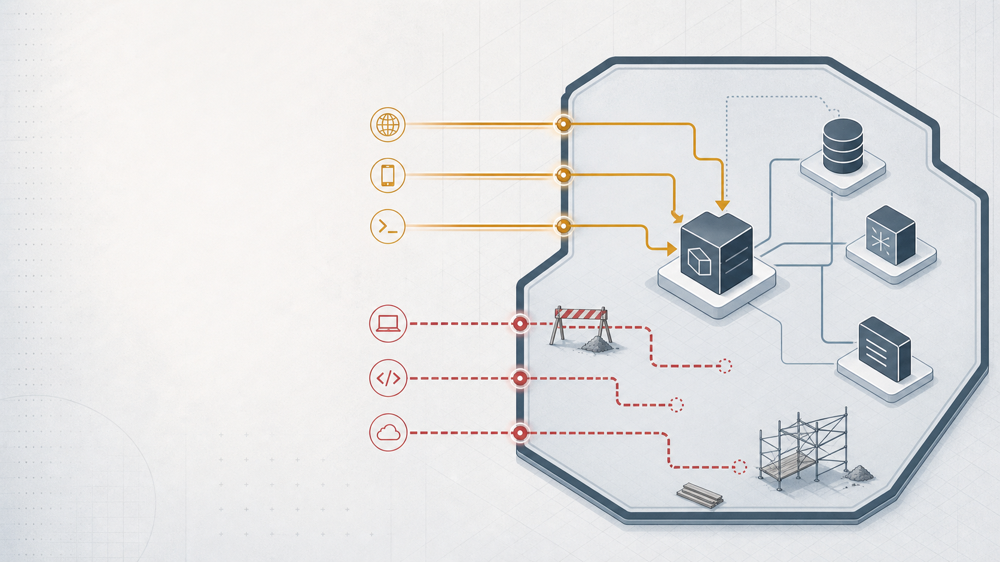

# What's open and why

*A transparent accounting of the public surfaces in the hackathon deployment—and the controls that still need to be added.*

A hackathon system has doors. If I pretend otherwise, someone with a port scanner will prove me wrong. So here's every door, why it's open, and what locks I'm putting on.

## The subdomain map

Caddy routes four subdomains on `ravencry.cv`.

`api.ravencry.cv` is the public API gateway. It has to be public. Citizens report missing persons through this endpoint. The PWA fetches active alerts. The SSE stream pushes live updates. There's no way around exposing the API. The gateway has rate limiting per endpoint, consistent error formatting, and the approval race condition guard at the database level. The surface area is as small as it can be while still functioning.

`api.ravencry.cv/telegram/*` accepts webhooks from Telegram's servers. Also public. Telegram needs to POST here when someone sends a message to the bot. The webhook handler acks in under ten milliseconds and processes asynchronously — Telegram retries slow responses, which would create duplicate cases. No authentication on this endpoint beyond Telegram's own request verification.

`api.ravencry.cv/ussd/*` accepts POST requests from Africa's Talking servers. Public. AT sends USSD session data here when a citizen dials `*384*72836#`. Same pattern as Telegram — third-party service needs to reach this endpoint.

(Note: Telegram and USSD are path-routed under the main `api.ravencry.cv` domain — they do not have dedicated subdomains. The Caddyfile uses `handle /telegram/*` and `handle /ussd/*` blocks within the `api.ravencry.cv` site block.)

Those three are public by necessity. The next three are public by development convenience, and that needs to change.

### Temporarily public

`crucix.ravencry.cv` exposes the Crucix HUD — the operator dashboard for the OSINT sweep engine. There's a TODO comment in the Caddyfile: `# TODO: re-add IP whitelist after testing`. During development, I needed to check sweep results from my phone, my laptop, and a test machine simultaneously. IP whitelisting would have meant constantly updating the Caddyfile. After the demo, this gets locked to a VPN IP range.

`n8n.ravencry.cv` exposes the n8n workflow editor. Same TODO, same reason. During development I was building and testing workflows from multiple devices. The webhook endpoints within n8n are protected by `N8N_WEBHOOK_SECRET` — incoming webhooks need a matching secret in the header. The editor UI has n8n's built-in authentication. But the editor itself shouldn't be on the public internet.

`ops.ravencry.cv` exposes the Appsmith ops dashboard. Same pattern. It's running but not configured. When the dashboard has real case data, operator tools, and approval workflows, this subdomain gets the strictest access control of all.

## The port map

> **Deployment caveat:** host port mappings were useful during the hackathon. In a production deployment, only Caddy should expose public ports; service-to-service traffic belongs on the internal Docker network.

The security group in the Terraform config opens four ports to `0.0.0.0/0`.

Port 22 for SSH. Standard. Key-based authentication with password fallback disabled in production. The key pair is generated by Terraform and stored in Alibaba Cloud. Private key lives on my machine.

Ports 80 and 443 for HTTP and HTTPS. Caddy handles redirect from 80 to 443. Let's Encrypt provisions certificates automatically.

Port 3001 for the Crucix API. This is the dev access port and the most obvious candidate for restriction. During the hackathon, I needed it open from wherever I was working. In production, it should only accept traffic from the VPN or the internal Docker network.

The Docker Compose file maps every service port to the host. In a production deployment behind a reverse proxy, services don't need host port mappings — they communicate over the internal Docker network and Caddy routes external traffic. The current config is a development artifact that survived into the demo.

## What authentication looks like right now

The API gateway now has a login route (`POST /api/auth/login`) using bcrypt password hashing against the `operators` table, JWT signing via `signToken`, `requireAuth` middleware on operator endpoints, and `requireRole` middleware for role-based access control. Demo mode (`AUTO_APPROVE_FLASH=true`) bypasses auth — that's the hackathon trade-off, not a missing implementation.

What's not yet implemented: token rotation, session expiry, MFA, and granular RBAC differentiating between operator roles at finer granularity than the current middleware supports. The RBAC matrix is specified in the design document. These are post-hackathon hardening items.

n8n's webhook endpoints are protected by `N8N_WEBHOOK_SECRET`. Every incoming webhook from Crucix or the API gateway includes this secret in a header. n8n verifies it before processing. This is simple shared-secret authentication — not ideal for production, but correct for the hackathon architecture where all components trust each other.

Caddy doesn't have `basicauth` configured on any subdomain. Adding HTTP basic auth to `crucix`, `n8n`, and `ops` subdomains would be a one-line change per subdomain in the Caddyfile. It's the quickest security win available.

## The env var surface

Several services use `env_file: .env` which shares the full dotenv file. Others have explicitly listed environment variables with only the values they need. Caddy has no environment variables at all. The sharing is not uniform across all containers — but services that do use `env_file` receive every variable, meaning a variable intended for the SMS service may also be visible to the LLM service, Crucix, and n8n.

This is how Compose works. It's not a vulnerability — the containers are all part of the same application — but it means an env var leak in any service exposes all secrets to whoever can read the container's environment.

Production should use Docker secrets or a proper secrets manager. AWS Secrets Manager is referenced in the design documents. Nothing reads from it yet. Every secret lives in `.env`, which is gitignored but exists in plaintext on the ECS instance.

The `.env.example` file is public in the repo. It shows the structure — variable names, placeholder values, inline comments — without real secrets. The dotenv parser treats inline comments as values, which caused a bug during development where an empty `LLM_MODEL=` with a trailing comment became the literal string `# (optional) override default model`. The fix: truly empty values with nothing after the `=`.

## The database connection

Aurora PostgreSQL is accessible from the ECS instance over the public internet. The code consumes `DATABASE_URL` but does not configure whether TLS is required or certificate verification is enabled — those depend on the Aurora parameter group and client settings. AWS Aurora supports TLS, but enforcing it requires explicit configuration on both ends. The ECS IP is whitelisted in the AWS RDS security group.

This is the cross-cloud pattern from the infrastructure article. It works because Aurora supports SSL connections from any IP. It's not ideal for production — a VPC peering connection or a VPN tunnel would keep database traffic off the public internet — but for a hackathon where the database is in one cloud and the compute is in another, SSL with IP whitelisting is the pragmatic choice.

The database password is in `DATABASE_URL` in `.env`. No rotation policy. No read-replica with reduced permissions for services that only need query access. Every service that needs the database gets the full connection string with write permissions.

## What the hardening roadmap looks like

First week of production hardening: IP whitelist on `crucix`, `n8n`, and `ops` subdomains. Three lines in the Caddyfile. Highest impact per minute spent.

Second: implement `decryptPhone()` and provision a KMS key. Until this exists, SMS delivery can't leave the sandbox and real subscriber data can't be stored. The AES-256-GCM design is correct. The implementation gap is the highest-priority security item.

Third: replace `api_key` header authentication with JWT. Add registration and login endpoints that use the existing `operators` table. Implement role-based access control matching the design document's RBAC matrix. Add token rotation and session expiry.

Fourth: circuit breaker on Africa's Talking. Three consecutive SMS failures skip SMS for that broadcast cycle and alert the ops channel via Telegram. Without this, an AT outage cascades into sequential timeouts across the subscriber list.

Fifth: input validation hardening on all public endpoints. Right now validation is per-endpoint but not comprehensive. A malformed phone number or an impossibly long name shouldn't reach the database. The validation layer exists. It needs expansion.

Sixth: Docker security hardening where it doesn't break functionality. Read-only root filesystems on services that don't need write access. Drop unnecessary Linux capabilities. Add seccomp profiles. These are defense-in-depth measures — none are urgent individually, all reduce blast radius collectively.

Seventh: database credential rotation. Move the Aurora password from `.env` to AWS Secrets Manager. Rotate it on a schedule. Create a read-only database user for services that only query, limiting the services that hold write credentials to the API gateway and n8n.

Eighth: Nigeria Data Protection Act 2023 (NDP Act) compliance review, under the Nigeria Data Protection Commission (NDPC). The NDP Act requires specific protections for citizen data — phone numbers count as personally identifiable information, location data requires a documented lawful basis and appropriate safeguards (consent is one possible basis, not the only one), and photos need retention policies. The intended S3 lifecycle policy would auto-expire uploads after three days — verify this against the deployed AWS configuration. A formal compliance review would identify gaps I haven't considered.

## The doors I'm not closing

The public API, Telegram webhook, and USSD callback endpoints stay public. They have to. The architecture decision is to minimize their attack surface — rate limiting, consistent error handling, input validation, no stack traces in error responses — rather than restricting access.

The SSE alert feed stays unauthenticated. It's a read-only stream of active alerts. Authenticating it would prevent the PWA from showing alerts to citizens who haven't signed up, which defeats the purpose.

Anonymous reporting stays enabled. The `reporter_phone` column in the cases table is a SHA-256 hash used for deduplication, not identity verification. Anyone can submit a report without proving who they are. This is deliberate. In high-mistrust regions, demanding identity before accepting a missing person report means some reports never get submitted. The trust scoring system will eventually weight anonymous reports lower than verified ones, but it won't reject them.

## What the auditor will find

If a security auditor reviewed this system tomorrow, here's what their report would say: public subdomains that should be IP-whitelisted, placeholder authentication on operator endpoints, plaintext secrets in environment variables, database accessible over the public internet with no credential rotation, no circuit breaker on the SMS provider, phone encryption designed but not implemented, and reverse image search for anti-fake not wired in.

Every single one of those findings is correct. Every single one has a documented fix. The difference between negligence and pragmatism is whether you wrote down what's wrong and what you plan to do about it.

The `pending_fix.md` file, the Caddyfile TODO comments, and the design document's security section together form a hardening roadmap. The system is not secure by production standards. It was never meant to be. It was meant to prove that the architecture works, that the AI pipeline functions, that the alert delivery reaches subscribers, that the multilingual triage handles five Nigerian languages.

It proves all of that. The next thirty-nine hours aren't about building new features. They're about locking the doors that had to stay open to get here.