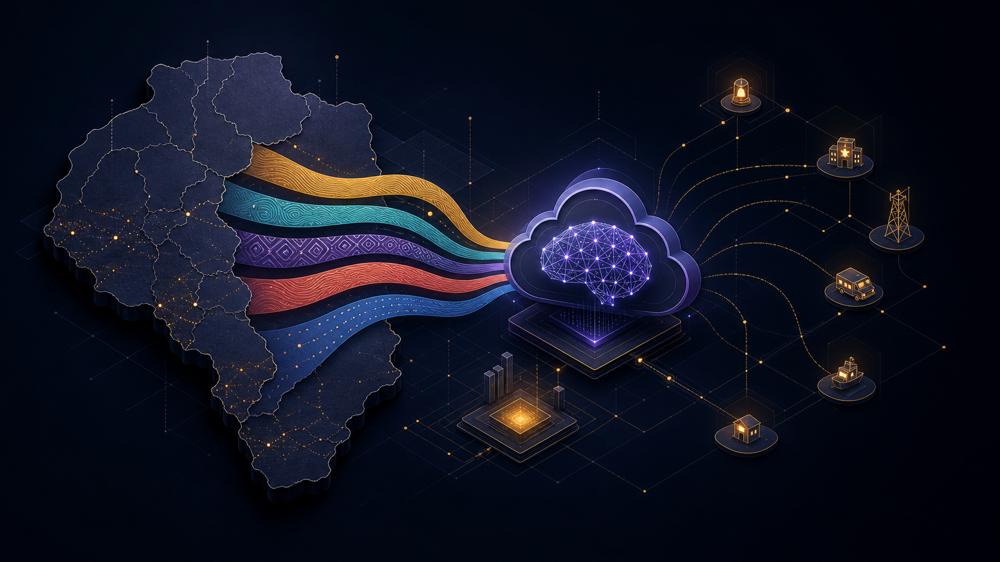
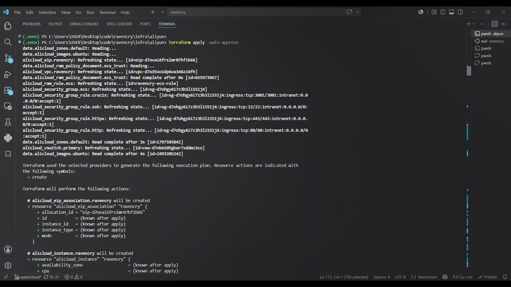
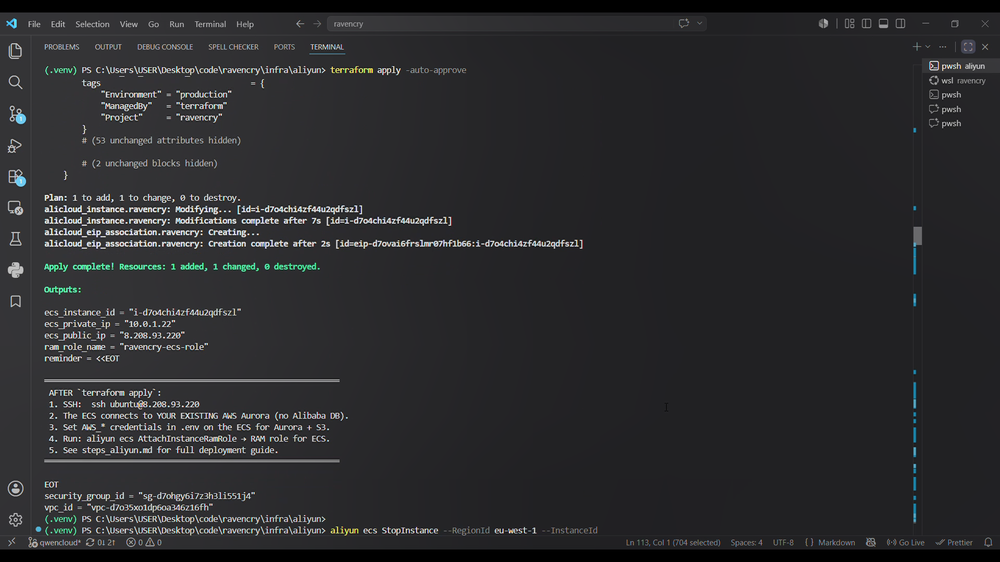
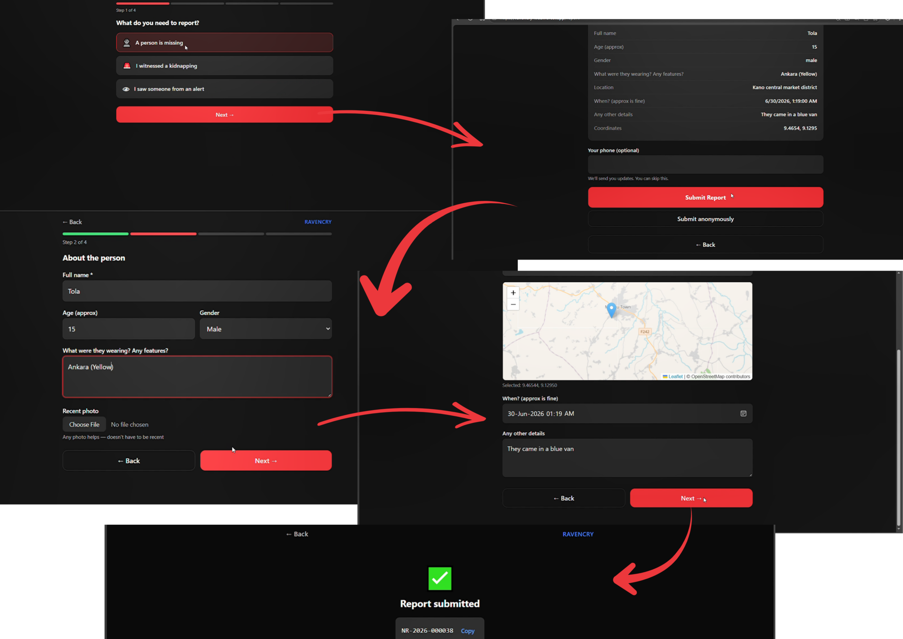
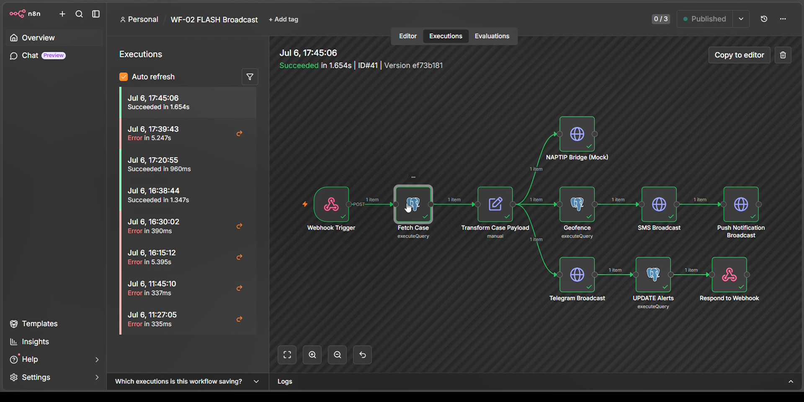
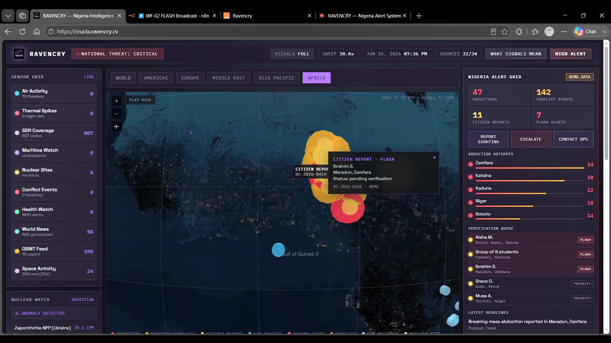
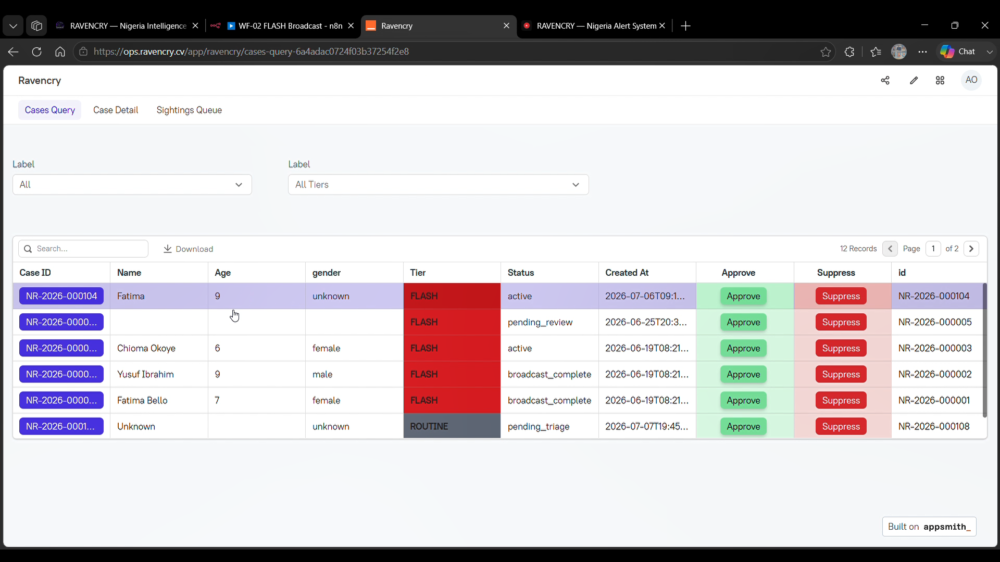
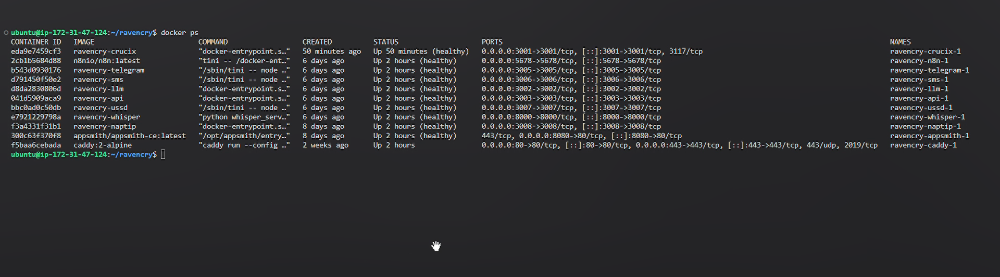

# Building RAVENCRY with Qwen Cloud: Five Languages, Four Focused AI Tasks



*A build log from RAVENCRY, a multilingual missing-persons alert prototype for Nigeria: how Qwen via DashScope shaped the intelligence layer, why Terraform mattered, and where the system still needs work.*

> **Build evidence:** [Terraform provisioning output](images/Screenshot-TF_aliyun_1.png) · [Terraform resource summary](images/Screenshot-TF_aliyun_2.png) · [working demo](https://www.youtube.com/watch?v=AT7ZC8Z8eNo)

A missing-person report may arrive in Hausa, Yoruba, Igbo, Nigerian Pidgin, English—or a few of them braided into one anxious sentence. The reporter may have a smartphone, or only a feature phone and a USSD menu. That constraint quietly shaped nearly every decision in RAVENCRY.

During the Qwen Cloud hackathon, we assembled a prototype that accepts reports through several channels. Qwen, accessed through Alibaba Cloud Model Studio/DashScope, handles four language tasks: extraction, severity classification, OSINT relevance classification, and authenticity assessment. Terraform captures the Alibaba Cloud infrastructure work; containers hold the application stack together.

This is an account of the useful parts, the awkward parts, and the questions we would want answered before placing a public-safety system in anyone’s hands.

## The problem was never simply translation

Language support is not a cosmetic feature in emergency reporting. A useful system has to preserve the details that make a report actionable: a person’s name, an age estimate, a location, the last-seen time, and the circumstances.

Consider a code-switched report such as:

> *“My pikin don disappear, a ganshi a Kasuwan Shanu.”*

Fluent English is beside the point if the location is transformed into something an operator cannot verify. We wanted the extraction service to return usable fields while retaining the original wording where it mattered. In this domain, an empty field is usually kinder than a handsome invention.

The resulting rule is almost stubbornly plain:

```text
If a field is not mentioned, return null.
Do not invent information.
```

## Qwen’s place in the stack

One model call should not be asked to do every kind of thinking. We split the language layer into four small jobs, each with a JSON response contract and a testable boundary.

| Task | What it receives | What it returns |
| --- | --- | --- |
| **QW-01 — extraction** | Raw citizen-report text and a language hint | Structured person, location, circumstance, and confidence fields |
| **QW-02 — severity** | Structured person and location context | `FLASH`, `PRIORITY`, or `ROUTINE`, with escalation factors |
| **QW-03 — OSINT relevance** | A headline, snippet, and source | Whether a news item is relevant and merits an operator draft |
| **QW-04 — authenticity** | Report text, with optional reporter phone and similar-report count | A trust-by-default verdict and the indicators behind it |

That division has a mundane advantage: when something is wrong, there is somewhere specific to look. Extraction can improve without disturbing escalation policy. OSINT filtering can change without rewriting the citizen-report path. It also made the Qwen calls easier to demonstrate: each has a visible input, a small answer, and a reason to exist.

## Prompt lessons we kept

### Name the languages

The extraction prompt names Hausa, Yoruba, Igbo, Nigerian Pidgin, and English as expected inputs. A short line changes the posture of the system: non-English text arrives as a first-class report, not an exception to recover from.

### Let uncertainty stay visible

Emergency reports are often fragmentary. Names, ages, descriptions, places, and times can all be absent. Nullable fields let an operator see what still needs asking instead of inheriting a convincing guess from the model.

### Put the escalation policy in the open

The severity prompt spells out its factors: a child aged 17 or under, an active abduction, weapons, multiple victims, or a listed high-risk state. The model returns a recommendation with its factors attached. It does not remove the need for accountable review or a policy that people can challenge.

### Give authenticity its own lane

Severity and credibility are different questions. QW-04 begins at a trust score of `0.7` and needs several red flags before recommending a hold for review. At present it is an advisory service. It is neither a complete verification pipeline nor a replacement for an operator.

### Tests are a floor, not a verdict

The LLM service includes tests for Hausa, Yoruba, Igbo, Pidgin, mixed-language extraction, classification, OSINT classification, and anti-fake defaults. They use mocked provider responses to guard the service contracts. That is good regression coverage; it says nothing yet about real-world multilingual accuracy. For that, we need a reviewed dataset and careful human evaluation.

## Terraform gave the cloud a paper trail

Qwen Cloud was a bit more than an API key in an environment file. Terraform let us describe the Alibaba Cloud environment once and provision it consistently, rather than rebuild the same network, compute, and security choices by hand.



*Terraform provisioning output from the build. It documents the infrastructure workflow; it does not claim that every application component was live on Alibaba Cloud at publication time.*



*Terraform’s resource summary leaves a concrete trail from infrastructure code to provisioned resources.*

Terraform does not negotiate with provider-side risk controls, regional capacity, or operating-system assumptions. It does, however, make the intended infrastructure reviewable. For a project that asks people to trust its decisions, that paper trail matters.

## Watching the pieces meet

The [end-to-end demo](https://www.youtube.com/watch?v=AT7ZC8Z8eNo) brings the PWA, n8n orchestration, Crucix OSINT interface, and operations dashboard into the same frame. Architecture diagrams are useful; seeing the hand-offs is more revealing.



*The citizen-facing PWA: a report flow and the alert experience it is designed to support.*



*The n8n workflow connects an approved alert to delivery services. It orchestrates a process; it does not make the final decision.*



*Crucix sits beside citizen reports as another source for operators to investigate.*



*The operations dashboard is where a human can inspect a case before acting on it.*



*Container status from the working stack. It shows the services assembled together, though it does not independently prove a production deployment or delivery to live recipients.*

## Where the edges still show

The prototype contains a Qwen-backed LLM service, container definitions, prompt templates, tests, and Terraform configuration. Its checked-in deployment configuration does not demonstrate that every component is production-ready or currently operating on Alibaba Cloud.

Some limitations are deliberately visible:

- QW-04 evaluates text and optional metadata. It has no image, EXIF, device-location, or reverse-image-search input.
- A provider failure returns an error from the LLM endpoint. The trust-by-default fallback applies only when a successful model call yields an empty or malformed parsed result.
- The anti-fake endpoint is not wired into report approval as an enforcement gate.
- Handling real reports would require stronger privacy controls, operator processes, integration agreements, monitoring, and measured multilingual evaluation.

Those limits are part of the build story. Pretending otherwise would make the demo smoother and the project less useful.

## What Qwen contributed

Qwen gave us a practical language layer that we could reach through DashScope and hold to small JSON contracts. That was enough to turn a set of messy messages into a series of reviewable questions: Who is missing? What happened? How urgent is it? What deserves a second look?

The interesting work begins after the model answers. Someone still has to ask whether the place name is right, whether the alert should travel, and whether the system has earned a community’s trust. RAVENCRY made those questions harder to ignore—which is a better outcome than making them disappear.

---

*RAVENCRY was built for the Qwen Cloud Hackathon. Explore the [source code](https://github.com/ravencry-labs/ravencry), watch the [demo](https://www.youtube.com/watch?v=AT7ZC8Z8eNo), and review Alibaba Cloud’s current [Qwen model pricing](https://www.alibabacloud.com/help/en/model-studio/model-pricing) separately by model, region, and input/output tokens.*
