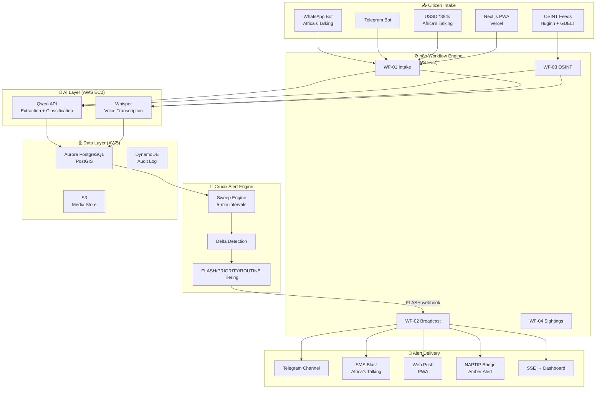

# Prompt 10 — Hackathon Submission Package
## Demo script · Devpost writeup · Pitch deck · Architecture diagram

---

## INSTRUCTION TO AI

Generate everything needed to win both hackathons. This is the submission layer — the work is built, now it needs to be communicated at maximum impact.

---

## PART A — 5-MINUTE DEMO SCRIPT

Structure the live demo or screen recording in exactly this order. Every second counts.

---

### [0:00 – 0:30] THE HOOK — Open with numbers, not features

**Script:**
> "In 2024, 2.2 million Nigerians were kidnapped. Families paid ₦2.23 trillion in ransoms.
> Nigeria has no real-time alert system that works on a feature phone.
> RAVENCRY fixes that. Let me show you."

**Screen:** Show a map of Nigeria with red dots representing 2023 kidnapping incidents by LGA.

---

### [0:30 – 1:30] DEMO FLOW 1 — A mother in Kano reports her missing child

**Script:**
> "A mother in Kano has no smartphone. She dials *384#."

**Screen:** USSD simulator — walk through the menu:
```
*384#
→ 1. Report missing person
→ Amina
→ 8
→ Kasuwan Shanu, Kano
→ Today 2pm
→ END: Report received. Case ID: NR-2025-000001
```

> "The same report works on WhatsApp, on our web app, and in Hausa."

**Switch to WhatsApp bot:** Show equivalent Hausa text submission being processed.

**Show:** Qwen extraction panel — raw Hausa text → structured JSON appearing in real time.

---

### [1:30 – 2:30] DEMO FLOW 2 — The AI processes it

**Screen:** Switch to ops dashboard (Appsmith)

**Script:**
> "In the background, Qwen — running in multiple Nigerian languages — classifies the report. 
> Child abduction in Zamfara? FLASH. Qwen knows the difference."

**Show:**
- Case arrives in ops dashboard: `status: pending_triage`
- Show Qwen classification output: `severity: FLASH`, `confidence: 0.94`, `reason: "Child abduction, high-risk LGA"`
- Show anti-fake score: `authenticity: 0.88 — proceed`
- Operator clicks ✅ Approve Broadcast

---

### [2:30 – 3:30] DEMO FLOW 3 — The alert fires

**Screen:** Split: Telegram channel + SMS delivery log + PWA

**Script:**
> "RAVENCRY broadcasts to everyone within 160 kilometres. Telegram. SMS. Push notification.
> And directly to NAPTIP's existing Amber Alert system."

**Show in rapid sequence:**
- Telegram channel: FLASH alert message appears with photo
- Africa's Talking dashboard: SMS delivery count ticking up
- PWA on mobile: push notification slides in, tap → alert detail page
- NAPTIP bridge: webhook response `200 OK`

**Delivery time:** Show timestamp — report to broadcast: under 90 seconds.

---

### [3:30 – 4:15] DEMO FLOW 4 — Community responds

**Screen:** PWA alert detail page

**Script:**
> "A driver in Kano sees the alert. One tap to report a sighting."

**Show:** Sighting form → submitted → ops dashboard sighting queue → map updates with sighting pin → investigator view.

> "Every confirmed sighting builds a movement timeline. Investigators can see exactly where to look."

---

### [4:15 – 5:00] THE VISION — Close with scale

**Screen:** Architecture diagram → ECOWAS map

**Script:**
> "RAVENCRY starts as a missing persons alert. But the infrastructure — the multilingual AI, the camera network, the community intelligence layer — becomes Nigeria's public safety operating system.
> Phase one: find the missing. Phase two: predict and prevent.
> The data layer we're building today becomes the nervous system for Nigerian security infrastructure.
> This is RAVENCRY."

---

## PART B — DEVPOST SUBMISSION WRITEUP

### Project title:
**RAVENCRY — Real-time AI for Vigilance, Event Notification, and Crisis Response Yielding**

### Tagline:
*Real-time anti-kidnapping and missing persons alerts for every Nigerian, on every device, in every language.*

### Inspiration:
Paste this (adapt as personal narrative):
> Nigeria faces a major kidnapping and missing-person challenge, yet there is no unified nationwide alert system capable of rapidly notifying citizens across smartphones, feature phones, social platforms, and community channels. Existing solutions are fragmented and often depend on specific platforms or agencies.

RAVENCRY was designed to close that gap. Rather than requiring a dedicated smartphone app, it reaches people through the channels they already use: WhatsApp, SMS, USSD, and community-based networks. This approach expands coverage to populations with limited internet access and increases the likelihood that critical alerts reach the people most likely to help.

### What it does:
> RAVENCRY is a real-time missing persons and anti-kidnapping alert platform that works across every channel Nigerians use. A family can report a missing child via USSD (*384#) with a feature phone, voice note in Hausa via WhatsApp, or a photo on our Progressive Web App. Qwen AI instantly classifies the report, extracts structured fields from any Nigerian language, and rates severity. Within 90 seconds of an operator approving a FLASH case, SMS alerts reach every opted-in subscriber within 160km, Telegram broadcasts to the public channel, push notifications fire on PWA users' devices, and NAPTIP's existing Amber Alert system is triggered. Investigators get a real-time ops dashboard showing sightings on a map and a movement timeline.

### How we built it:
> **AI layer:** Qwen (`qwen-plus` for FLASH cases, `qwen-turbo` for OSINT) handles multilingual extraction and severity classification. Whisper (open-source, CPU-only) transcribes Hausa and Yoruba voice notes. Four specialised prompt templates handle: field extraction, severity classification, OSINT filtering, and anti-fake detection.
>
> **Alert engine:** Crucix (forked and extended) runs 5-minute sweeps across NAPTIP RSS, GDELT, Nigerian news RSS, and our citizen reports database. The delta engine prevents duplicate alerts.
>
> **Workflow:** n8n orchestrates the full pipeline — intake → triage → storage → broadcast — with visual, auditable workflows for each channel.
>
> **Infrastructure:** Aurora PostgreSQL with PostGIS for geospatial subscriber queries. DynamoDB for immutable audit trail. S3 for media with automated deletion of source photos after 72 hours. Deployed on Vercel (frontend) and AWS EC2 (backend services via Docker Compose).
>
> **Channels:** Africa's Talking for SMS and USSD. Telegram bot API. Web Push API. Next.js PWA with offline support and service worker caching.

### Challenges we ran into:
> 1. **Nigerian language quality in Qwen:** Code-switching (Yoruba-English mixing, Hausa transliteration variation) required prompt engineering to handle edge cases without hallucinating structured fields.
> 2. **USSD statefulness:** USSD is inherently stateless — every request arrives without session context. We rebuilt a lightweight state machine on DynamoDB with 5-minute TTL sessions.
> 3. **Geofencing without real phone coordinates:** Most feature phone reporters have no GPS. We geocode the location text they provide (e.g. "Kasuwan Shanu, Kano") using OSM Nominatim and fall back to LGA-level matching for subscribers.
> 4. **False alert risk:** Nigeria has a known problem with recycled kidnapping images on WhatsApp. The anti-fake detection prompt + trust scoring catches most of these before broadcast.

### Accomplishments we're proud of:
> - Full Hausa, Yoruba, Igbo, and Pidgin support in a single Qwen prompt
> - 90-second report-to-broadcast latency on FLASH cases
> - Works on feature phones via USSD — reaching the populations most affected
> - NAPTIP bridge: extends the existing government system instead of competing with it
> - Zero raw biometric data stored — privacy-first by design

### What we learned:
> Qwen's multilingual capacity for West African languages is genuinely impressive — particularly its handling of code-switching and Pidgin English, which no standard NLP pipeline handles well. The hard lesson was infrastructure: getting Africa's Talking USSD, n8n, Crucix, and Aurora talking to each other reliably required careful error boundary design at every integration point. Graceful degradation — the system continues even when any one integration fails — was the most important engineering decision we made.

### What's next for RAVENCRY:
> - **V2 (Month 1–2):** Opt-in private camera network (filling stations, banks, schools). Facial recognition on citizen-submitted sightings (InsightFace). Drone search-and-rescue feed integration.
> - **V3 (Month 3–6):** Predictive hotspot model using historical incident data. Highway monitoring on Abuja-Kaduna corridor. Community vigilante integration (Amotekun, Civilian JTF).
> - **Scale:** Pan-African expansion via ECOWAS security data sharing framework.

### Built with:
`Qwen API`, `Next.js`, `Vercel`, `AWS Aurora PostgreSQL`, `AWS DynamoDB`, `AWS S3`, `Node.js`, `Crucix`, `n8n`, `Huginn`, `Whisper`, `Africa's Talking`, `Telegram Bot API`, `PostGIS`, `Leaflet.js`, `Docker`, `Appsmith`

---

## PART C — ARCHITECTURE DIAGRAM SPEC

Generate this as a Mermaid diagram (`architecture.mermaid`) for embedding in README:



---

## PART D — README.MD

Produce a complete `README.md` for the GitHub repo:

Sections:
1. **Header** — RAVENCRY logo placeholder + badges (Vercel deployed, AWS, Qwen powered)
2. **The problem** — 2 paragraphs, Nigeria statistics
3. **What RAVENCRY does** — bullet list, max 8 bullets
4. **Architecture diagram** — embed Mermaid or PNG
5. **Tech stack table** — all tools with purpose column
6. **Quick start** — 10-step setup guide (clone → env → docker-compose up → migrate → seed → demo)
7. **Environment variables** — full table from `.env.example`
8. **API reference** — table of all endpoints
9. **Demo** — link to Vercel URL + YouTube/Loom recording
10. **Hackathon** — Qwen Cloud + H01 Devpost badges and links
11. **Roadmap** — V2/V3 table
12. **Contributing** — brief (it's a hackathon, but include)
13. **License** — MIT

---

## PART E — PRE-SUBMISSION CHECKLIST

Run through this completely before hitting Submit:

### Code & Deployment
- [ ] All services running on EC2: `docker-compose ps` shows all healthy
- [ ] Vercel frontend live: confirm URL loads on 3G throttle (Chrome DevTools)
- [ ] PWA installs on Android
- [ ] All `.env` keys set in Vercel Environment Variables and AWS Secrets Manager
- [ ] No API keys committed to git (run `git log --all -S "sk-" --source`)

### Functionality
- [ ] End-to-end test passed (USSD → case → FLASH → SMS delivered)
- [ ] Qwen API calls visible in Qwen Cloud console
- [ ] Aurora DB: `SELECT COUNT(*) FROM cases` returns seed data
- [ ] DynamoDB: ravencry-alerts table has at least 1 item from test broadcast

### Submission Assets
- [ ] 5-minute demo recording (Loom or OBS, 1080p minimum)
- [ ] Architecture diagram exported as PNG (1920px wide)
- [ ] Mermaid source committed to repo
- [ ] All Devpost fields filled (title, tagline, description, tech stack, video, URLs)
- [ ] GitHub repo: public, README complete, last commit clean
- [ ] Qwen submission form: API usage logs attached
- [ ] H01 Devpost: Vercel URL + AWS screenshot attached as proof

### Legal / Safety
- [ ] No real personal data in seed database
- [ ] Operator default password documented as "must change" in README
- [ ] Privacy notice on PWA (what data is collected, retention periods)
- [ ] AUTO_APPROVE mode: confirm it is documented as demo-only
